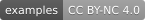

# Pecha

**English** · [Português](README.pt-BR.md)

  

*Scene from the opening of Little Buddha, by Bernardo Bertolucci (1993). Watch the scene on YouTube: [dubbed in Portuguese](https://youtu.be/cAbgJ4YUvE4?t=15s) or [original in English](https://youtu.be/qG78yS0sScA).*

My first visual contact with the Tibetan script was in the opening scenes of *Little Buddha*, by Bernardo Bertolucci, released in 1993. In these scenes, a pecha tells a story from the Jātakas, the tales of the Buddha's past lives. We see both the leaves in the traditional format and the letters floating on the screen.

Later, I connected with the Dharma, especially with the Himalayan Vajrayāna traditions, and over time studied a little Tibetan and became interested in the traditional style of pechas. At first, making pechas on a computer took a lot of work. Today, with advances in technology and Tibetan typography, there are resources that help preserve the traditional style of sūtras, prayers and sādhanas.

I hope the skill helps those who want their texts in a format closer to the traditional one and that, in the long run, it contributes to preserving the texts and Tibetan culture. It can also support even more important initiatives, such as the digitization and translation of Tibetan texts into English and other languages. May this be of benefit to practitioners, not necessarily out of academic curiosity, but for the genuine Dharma practice.

— Jamyang Zopa

## The Skill

 
 

*The cover, pecha 2 in Tibetan only and pecha 6 in Tibetan, transliteration and translation of the Heart Sūtra, generated by this skill from the Lotsawa House page [Heart Sūtra (with Extras)](https://www.lotsawahouse.org/words-of-the-buddha/heart-sutra-with-extras), translated by Adam Pearcey. Text under CC BY-NC 4.0, for study and practice only.*

A skill for Claude that lays out Tibetan liturgical texts as a pecha to print: two pechas of 297 × 105 mm on each A4 landscape sheet, with a double frame, Tibetan page numbers, a cover and a credits page. The text comes from a [Lotsawa House](https://www.lotsawahouse.org) page. A pecha can come out in Tibetan only, in the more traditional format, or with transliteration and translation, which is useful for those studying Tibetan.

The skill reads the layers as each Lotsawa House page marks them, and copies the Tibetan exactly. It does not retype or retranslate anything. The last pecha of every PDF carries the credits that the page gives: source, translator, version, address and licence.

To see how the skill reads the page and builds the pecha, and why it was designed this way, read [How the skill works inside](docs/how-it-works.md).

## Example Pechas

> [!IMPORTANT]
> Only texts that Lotsawa House presents **without a requirement** of empowerment or transmission are included.

Twelve pechas made by this skill, ready to download and look at: seven in Tibetan, transliteration and translation, two in transliteration and translation, and two in Tibetan only, one with the thick line outside the frame and one with it inside. One more is in two blocks: all the Tibetan first, then the transliteration and translation.

- [Heart Sūtra (with Extras)](examples/heart-sutra-with-extras.pdf), translated by Adam Pearcey, from [Lotsawa House](https://www.lotsawahouse.org/words-of-the-buddha/heart-sutra-with-extras); recitation: [video 1](https://youtu.be/-TWtQu79mkk), [video 2](https://youtu.be/gR3aiyZVKWc)
- [The Sūtra of Boundless Life](examples/sutra-boundless-life.pdf), Tibetan only, with the thick line inside the frame, from the page translated by Adam Pearcey, from [Lotsawa House](https://www.lotsawahouse.org/words-of-the-buddha/sutra-boundless-life); recitation: [video](https://youtu.be/fiy8z-pr9EY)
- [Noble Sūtra of Recalling the Three Jewels](examples/sutra-recalling-three-jewels.pdf), translated by Rigpa Translations, 2001, from [Lotsawa House](https://www.lotsawahouse.org/words-of-the-buddha/sutra-recalling-three-jewels); recitation: [video](https://youtu.be/zvb1xGm1KHw)
- [Maitreya's Aspiration](examples/maitreyas-aspiration.pdf), translated by Samye Translations, from [Lotsawa House](https://www.lotsawahouse.org/words-of-the-buddha/maitreyas-aspiration); recitation: [video](https://youtu.be/H7s-z8V07HY)
- [Seven Branches from Zangchö Mönlam](examples/seven-branch-zangcho-monlam.pdf), transliteration and translation, translated by Rigpa Translations, 1996, from [Lotsawa House](https://www.lotsawahouse.org/words-of-the-buddha/seven-branch-zangcho-monlam); recitation: [video](https://youtu.be/rZuH_d8JB2E)
- [Auspicious Verses of Seven Buddhas](examples/auspicious-verses-of-seven-buddhas.pdf), transliteration and translation, translated by Adam Pearcey, from [Lotsawa House](https://www.lotsawahouse.org/words-of-the-buddha/auspicious-verses-of-seven-buddhas)
- [Verses of the Eight Noble Auspicious Ones](examples/verses-eight-noble-auspicious-ones.pdf), translated by Rigpa Translations, 2010, from [Lotsawa House](https://www.lotsawahouse.org/tibetan-masters/mipham/verses-eight-noble-auspicious-ones); recitation: [video](https://youtu.be/j0yQS70S2BE)
- [Praises to the Twenty-One Tārās](examples/twenty-one-tara-praise.pdf), Tibetan only, with the thick line outside the frame, from the page translated by Samye Translations, from [Lotsawa House](https://www.lotsawahouse.org/words-of-the-buddha/twenty-one-tara-praise); recitation: [video 1](https://youtu.be/kM6FQPAHC6Q), [video 2](https://youtu.be/KbwNPVg_mTE)
- [Leu Dünma, chapter 7: Sampa Lhundrupma](examples/leu-dunma-chapter-7.pdf), translated by Rigpa Translations, from [Lotsawa House](https://www.lotsawahouse.org/tibetan-masters/tulku-zangpo-drakpa/leu-dunma-chapter-7); recitation: [video 1](https://youtu.be/1AMMlmWO8ek), [video 2](https://youtu.be/O0fbuU10w0A)
- [Barche Lamsel](examples/barche-lamsel.pdf), the prayer that removes all obstacles from the path, translated by Rigpa Translations, 2013, from [Lotsawa House](https://www.lotsawahouse.org/tibetan-masters/chokgyur-dechen-lingpa/barche-lamsel); recitation: [video 1](https://youtu.be/j0yQS70S2BE), [video 2](https://youtu.be/A0Xphzmawtk)
- [Treasury of Blessings](examples/treasury-blessings-practice-buddha-shakyamuni.pdf), a practice of Buddha Śākyamuni, in two blocks, translated by Rigpa Translations (with reference to existing versions), from [Lotsawa House](https://www.lotsawahouse.org/tibetan-masters/mipham/treasury-blessings-practice-buddha-shakyamuni); recitation: [video 1](https://youtu.be/SbU3WiSdFSQ), [video 2](https://youtu.be/z8Kvsq1Wwrk)
- [Dedication of Merit](examples/dedication-sonam-di-yi.pdf), translated by Rigpa Translations, from [Lotsawa House](https://www.lotsawahouse.org/words-of-the-buddha/dedication-sonam-di-yi)

> [!WARNING]
> They are unreviewed examples: please review a pecha before you use it for study and practice.

The texts and translations are under CC BY-NC 4.0, shared here, non-profit, for the study and practice of the Dharma. More details on each one are in [`examples/`](examples/README.md).

## Make Your Own

1. Download the skill: [pecha-2026.10.15a.skill](https://github.com/eltonmelo21/pecha/releases/download/v2026.10.15a/pecha-2026.10.15a.skill), the current version.
2. In Claude, click your initials and name, then **Settings**. Under **Customize**, click **Skills**, then **+**, **+ Create skill** and **Upload a skill**, and choose the file.
3. Ask Claude: `Make a pecha of this Lotsawa House page: https://www.lotsawahouse.org/...`

It works the same on claude.ai and in the desktop app; on the phone, install it from a computer and it shows up there too. First time? The guide [How to use the pecha skill](docs/how-to-use.md) shows each step, with what to turn on in Claude's settings. Open every page of the PDF before you print it.

Every pecha is prepared with the help of artificial intelligence. It must be reviewed before it is used for study and practice.

## Tibetan Script and the Google Noto Font

*Image: Google. Click it to watch the video on YouTube. More about the fonts at [fonts.google.com/noto](https://fonts.google.com/noto).*

The Tibetan text is set in Noto Serif Tibetan, part of the [Noto](https://fonts.google.com/noto) family of fonts by Google, made to cover the writing systems of the world. The fonts are developed in the open, in the [Noto project on GitHub](https://github.com/notofonts/tibetan). To learn more about the script itself, read [The Tibetan script](docs/tibetan-script.md), with its origin and the alphabet, or see [Tibetan script](https://en.wikipedia.org/wiki/Tibetan_script) on Wikipedia.

## For Translators

Thank you to everyone who translates the Dharma! Buddhist teachings say that those who translated the words of the Buddha centuries ago still accumulate great merit today. Their work made these teachings accessible to other peoples.

The same is true of today's translators. They digitise and translate the Dharma into other languages, including Western ones, and make it more accessible through the skilful means that the internet allows.

I hope this skill can support their work and help to preserve and pass on the teachings, especially those of the Tibetan tradition, for future generations. If you translate and would like to talk about the project, this repository's [Discussions](https://github.com/eltonmelo21/pecha/discussions) are open.

## For Institutions

Pecha is a non-profit initiative, and the door is open for a foundation, a university or another institution, with more resources for artificial intelligence and more time, to carry the work on and bring it to more people.

How that could happen is in [Governance](GOVERNANCE.md). The ideas for the next stages are in [Ideas for the Future](docs/future.md). To talk about it, just open a conversation in the [Partnerships](https://github.com/eltonmelo21/pecha/discussions/categories/partnerships) category of this repository's Discussions.

## Licences and Credits

| Part | Licence |
|---|---|
| Code (`SKILL.md`, `scripts/`, `assets/pecha-engine.html`, `references/`) | MIT, see [`LICENSE.txt`](LICENSE.txt) |
| Noto fonts (`assets/fonts/`) | SIL Open Font License 1.1 (OFL), see [`OFL.txt`](assets/fonts/OFL.txt) |
| Example pechas (`examples/`) and the image above | CC BY-NC 4.0, for non-commercial use with attribution |

The CC BY-NC 4.0 licence that Lotsawa House uses allows the texts to be adapted for non-commercial use, with attribution. It is what makes these pechas possible.

- Texts and translations: [Lotsawa House](https://www.lotsawahouse.org) and its translators.
- Fonts: [The Noto Project Authors](https://fonts.google.com/noto).

---

Made with 🙏 in Osasco, São Paulo, Brazil 🙂
