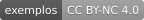

# Pecha

[English](README.md) · **Português**

    

*Cena do início do filme O Pequeno Buda, de Bernardo Bertolucci (1993). Veja a cena no YouTube: [dublada em português](https://youtu.be/cAbgJ4YUvE4?t=15s) ou [original em inglês](https://youtu.be/qG78yS0sScA).*

Meu primeiro contato visual com a escrita tibetana foi nas cenas iniciais do filme *O Pequeno Buda*, de Bernardo Bertolucci, lançado em 1993. Nessas cenas, uma pecha conta uma narrativa dos Jātakas, os contos das vidas passadas do Buddha. Aparecem tanto as folhas no formato tradicional quanto as letras flutuando na tela.

Depois, me conectei com o Dharma, em particular com as tradições Vajrayāna do Himalaia, e com o tempo estudei um pouco de tibetano e me interessei pelo estilo tradicional das pechas. No começo, fazer pechas no computador dava muito trabalho. Hoje, com os avanços da tecnologia e da tipografia tibetana, há recursos que ajudam a preservar o estilo tradicional dos sūtras, das preces e das sādhanas.

Espero que a skill ajude quem quer ter os textos num formato mais próximo do tradicional e que, a longo prazo, contribua para a preservação dos textos e da cultura tibetana. Ela também pode apoiar iniciativas ainda mais importantes, como a digitalização e a tradução de textos tibetanos para o inglês e outras línguas. Que isso possa ser de benefício para os praticantes, não necessariamente pela curiosidade acadêmica, mas pela genuína prática do Dharma.

— Jamyang Zopa

## A Skill

 
 

*A capa, a pecha 2 só em tibetano e a pecha 6 em tibetano, transliteração e tradução do Sūtra do Coração, geradas por esta skill a partir da página da Lotsawa House [Heart Sūtra (with Extras)](https://www.lotsawahouse.org/words-of-the-buddha/heart-sutra-with-extras), traduzida por Adam Pearcey. Texto sob CC BY-NC 4.0, só para estudo e prática.*

Uma skill para o Claude que diagrama textos litúrgicos tibetanos como pecha para imprimir: duas pechas de 297 × 105 mm em cada folha A4 paisagem, com moldura dupla, numeração em algarismos tibetanos, capa e página de créditos. O texto vem de uma página da [Lotsawa House](https://www.lotsawahouse.org). A pecha pode sair só em tibetano, no formato mais tradicional, ou com transliteração e tradução, o que é útil para quem está estudando tibetano.

> [!IMPORTANT]
> Só entram textos que a Lotsawa House apresenta **sem exigência** de iniciação ou transmissão. Como toda pecha é preparada com apoio de inteligência artificial, revise cada uma antes de imprimir para o estudo e a prática.

A skill lê as camadas como cada página da Lotsawa House as marca e copia o tibetano exatamente. Ela não redigita nem retraduz nada. A última pecha de cada PDF traz os créditos que a página informa: fonte, tradutor, versão, endereço e licença. Para ver como a skill lê a página e monta a pecha, e por que ela foi desenhada assim, leia [Como a skill funciona por dentro](docs/como-funciona.md).

## Pechas de Exemplo

Três pechas geradas por esta skill, uma para cada forma de montar o texto, prontas para baixar e conhecer.

- [Heart Sūtra (with Extras)](library/heart-sutra-with-extras.pdf): três camadas, duas linhas finas. Tradução de Adam Pearcey, da [Lotsawa House](https://www.lotsawahouse.org/words-of-the-buddha/heart-sutra-with-extras). Recitação: [vídeo 1](https://youtu.be/-TWtQu79mkk), [vídeo 2](https://youtu.be/gR3aiyZVKWc)
- [Tesouro de Bênçãos](library/treasury-blessings-practice-buddha-shakyamuni.pdf) (*Treasury of Blessings*): dois blocos, linha grossa por dentro. Tradução de Rigpa Translations (com referência a versões existentes), da [Lotsawa House](https://www.lotsawahouse.org/tibetan-masters/mipham/treasury-blessings-practice-buddha-shakyamuni). Recitação: [vídeo 1](https://youtu.be/SbU3WiSdFSQ), [vídeo 2](https://youtu.be/z8Kvsq1Wwrk)
- [Louvor às 21 Taras](library/twenty-one-tara-praise.pdf) (*Praises to the Twenty-One Tārās*): só tibetano, linha grossa por fora. Tradução de Samye Translations, da [Lotsawa House](https://www.lotsawahouse.org/words-of-the-buddha/twenty-one-tara-praise). Recitação: [vídeo 1](https://youtu.be/kM6FQPAHC6Q), [vídeo 2](https://youtu.be/KbwNPVg_mTE)

Mais pechas, agrupadas por tipo de texto, estão na [Biblioteca de Pechas](library/README.pt-BR.md), que cresce aos poucos.

Os textos e as traduções estão sob CC BY-NC 4.0, compartilhados aqui sem fins lucrativos, para o estudo e a prática do Dharma.

## Como Gerar a Sua

1. Baixe a skill: [pecha-2026.10.16b.skill](https://github.com/eltonmelo21/pecha/releases/download/v2026.10.16b/pecha-2026.10.16b.skill), a versão atual.
2. No Claude, clique nas suas iniciais e no seu nome, depois em **Settings**. Em **Customize**, clique em **Skills**, depois em **+**, **+ Create skill** e **Upload a skill**, e escolha o arquivo.
3. Peça ao Claude: `Faça uma pecha desta página da Lotsawa House: https://www.lotsawahouse.org/...`

> [!TIP]
> Use o Claude Sonnet ou um modelo maior. Nos testes feitos até agora, o esforço baixo bastou. Em casos mais complexos, um modelo maior, como o Opus, ou um esforço mais alto podem ser necessários. Para falar em vez de digitar, use o ditado: o microfone 🎙️ na caixa de mensagem.

Primeira vez? O guia [Como usar a skill pecha](docs/como-usar.md) mostra cada passo, com o que ligar nas configurações do Claude. Funciona do mesmo jeito no claude.ai e no aplicativo para computador; no celular, instale pelo computador e ela aparece lá também.

## A Escrita Tibetana e a Fonte Google Noto

*Imagem: Google. Clique nela para ver o vídeo no YouTube. Mais sobre as fontes em [fonts.google.com/noto](https://fonts.google.com/noto).*

O texto tibetano sai em Noto Serif Tibetan, da família de fontes [Noto](https://fonts.google.com/noto), do Google, feita para cobrir os sistemas de escrita do mundo. As fontes são desenvolvidas de forma aberta, no [projeto Noto no GitHub](https://github.com/notofonts/tibetan). Para conhecer mais a própria escrita, leia [A escrita tibetana](docs/escrita-tibetana.md), com a origem e o alfabeto, ou veja [Tibetan script](https://en.wikipedia.org/wiki/Tibetan_script) na Wikipedia.

## Para Tradutores e Instituições

Os ensinamentos budistas dizem que aqueles que traduziram as palavras do Dharma há séculos continuam acumulando grandes méritos até hoje. Foi o trabalho deles que tornou esses ensinamentos acessíveis a outros povos. O mesmo vale para os tradutores de hoje: eles digitalizam e traduzem esses ensinamentos para outros idiomas e os tornam mais acessíveis pelos meios hábeis que a internet permite.

> [!NOTE]
> Pecha é uma iniciativa sem fins lucrativos, e as portas estão abertas para que uma fundação, uma universidade ou outra instituição, com mais recursos de inteligência artificial e mais tempo, continue o trabalho e o leve a mais pessoas.

Espero que esta skill possa apoiar esse trabalho e ajudar a preservar e a transmitir os ensinamentos, principalmente da tradição tibetana, para as gerações futuras. Se você traduz e quer conversar sobre o projeto, as [Discussões](https://github.com/eltonmelo21/pecha/discussions) deste repositório estão abertas. Como essa continuidade poderia acontecer está em [Governança](GOVERNANCE.pt-BR.md). As ideias para as próximas etapas estão em [Ideias para o Futuro](docs/futuro.md). Para conversar, é só abrir uma conversa na categoria [Partnerships](https://github.com/eltonmelo21/pecha/discussions/categories/partnerships) das Discussões deste repositório.

## Licenças e Créditos

| Parte | Licença |
|---|---|
| Código (`SKILL.md`, `scripts/`, `assets/pecha-engine.html`, `references/`) | MIT, veja [`LICENSE.txt`](LICENSE.txt) |
| Fontes Noto (`assets/fonts/`) | SIL Open Font License 1.1 (OFL), veja [`OFL.txt`](assets/fonts/OFL.txt) |
| Pechas de exemplo (`library/`) e a imagem do topo | CC BY-NC 4.0, para uso sem fins comerciais, com atribuição |

A licença CC BY-NC 4.0, que a Lotsawa House usa, permite adaptar os textos para uso sem fins comerciais, com atribuição. É ela que torna estas pechas possíveis.

- Textos e traduções: [Lotsawa House](https://www.lotsawahouse.org) e seus tradutores.
- Fontes: [The Noto Project Authors](https://fonts.google.com/noto).

---

Feito com 🙏 em Osasco, São Paulo, Brasil 🙂
