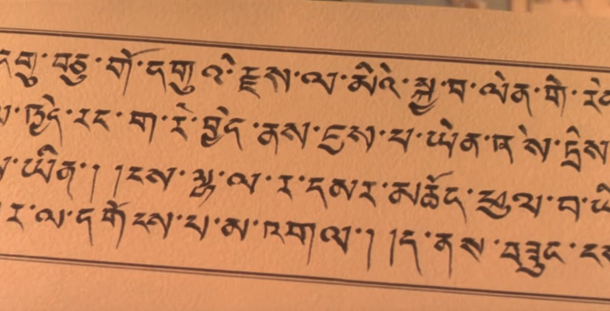
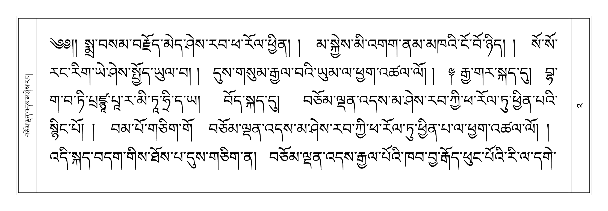
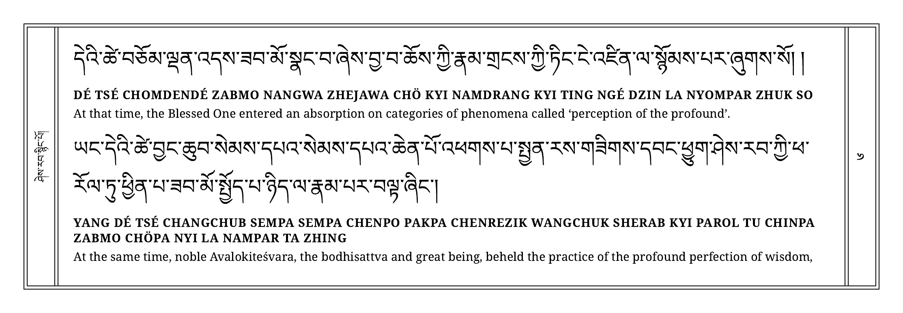

# Pecha

[English](README.md) · **Português**

  

*Cena do início do filme O Pequeno Buda, de Bernardo Bertolucci (1993). Veja a cena no YouTube: [dublada em português](https://youtu.be/cAbgJ4YUvE4?t=15s) ou [original em inglês](https://youtu.be/qG78yS0sScA).*

Meu primeiro contato visual com a escrita tibetana foi nas cenas iniciais do filme *O Pequeno Buda*, de Bernardo Bertolucci, lançado em 1993. Nessas cenas, uma pecha conta uma narrativa dos Jātakas, os contos das vidas passadas do Buddha. Aparecem tanto as folhas no formato tradicional quanto as letras flutuando na tela.

Depois, me conectei com o Dharma, em particular com as tradições Vajrayāna do Himalaia, e com o tempo estudei um pouco de tibetano e me interessei pelo estilo tradicional das pechas. No começo, fazer pechas no computador dava muito trabalho. Hoje, com os avanços da tecnologia e da tipografia tibetana, há recursos que ajudam a preservar o estilo tradicional dos sūtras, das preces e das sādhanas.

Espero que a skill ajude quem quer ter os textos num formato mais próximo do tradicional e que, a longo prazo, contribua para a preservação dos textos e da cultura tibetana. Ela também pode apoiar iniciativas ainda mais importantes, como a digitalização e a tradução de textos tibetanos para o inglês e outras línguas. Que isso possa ser de benefício para os praticantes, não necessariamente pela curiosidade acadêmica, mas pela genuína prática do Dharma.

— Jamyang Zopa

## A Skill

 
 

*A capa, a pecha 2 só em tibetano e a pecha 6 em tibetano, transliteração e tradução do Sūtra do Coração, geradas por esta skill a partir da página da Lotsawa House [Heart Sūtra (with Extras)](https://www.lotsawahouse.org/words-of-the-buddha/heart-sutra-with-extras), traduzida por Adam Pearcey. Texto sob CC BY-NC 4.0, só para estudo e prática.*

Uma skill para o Claude que diagrama textos litúrgicos tibetanos como pecha para imprimir: duas pechas de 297 × 105 mm em cada folha A4 paisagem, com moldura dupla, numeração em algarismos tibetanos, capa e página de créditos. O texto vem de uma página da [Lotsawa House](https://www.lotsawahouse.org). A pecha pode sair só em tibetano, no formato mais tradicional, ou com transliteração e tradução, o que é útil para quem está estudando tibetano.

A skill lê as camadas como cada página da Lotsawa House as marca e copia o tibetano exatamente. Ela não redigita nem retraduz nada. A última pecha de cada PDF traz os créditos que a página informa: fonte, tradutor, versão, endereço e licença.

Para ver como a skill lê a página e monta a pecha, e por que ela foi desenhada assim, leia [Como a skill funciona por dentro](docs/como-funciona.md).

## Pechas de Exemplo

> [!IMPORTANT]
> Só entram textos que a Lotsawa House apresenta **sem exigência** de iniciação ou transmissão.

Doze pechas geradas por esta skill, prontas para baixar e conhecer: sete em tibetano, transliteração e tradução, duas em transliteração e tradução e duas só em tibetano, uma com a linha grossa por fora da moldura e outra com ela por dentro. Mais uma vem em dois blocos: todo o tibetano primeiro, depois a transliteração e a tradução.

- [Heart Sūtra (with Extras)](examples/heart-sutra-with-extras.pdf), tradução de Adam Pearcey, da [Lotsawa House](https://www.lotsawahouse.org/words-of-the-buddha/heart-sutra-with-extras); recitação: [vídeo 1](https://youtu.be/-TWtQu79mkk), [vídeo 2](https://youtu.be/gR3aiyZVKWc)
- [Sūtra da Vida Ilimitada](examples/sutra-boundless-life.pdf) (*The Sūtra of Boundless Life*), só em tibetano, com a linha grossa por dentro da moldura, da página com tradução de Adam Pearcey, da [Lotsawa House](https://www.lotsawahouse.org/words-of-the-buddha/sutra-boundless-life); recitação: [vídeo](https://youtu.be/fiy8z-pr9EY)
- [Nobre Sūtra da Recordação das Três Joias](examples/sutra-recalling-three-jewels.pdf) (*Noble Sūtra of Recalling the Three Jewels*), tradução de Rigpa Translations, 2001, da [Lotsawa House](https://www.lotsawahouse.org/words-of-the-buddha/sutra-recalling-three-jewels); recitação: [vídeo](https://youtu.be/zvb1xGm1KHw)
- [Maitreya's Aspiration](examples/maitreyas-aspiration.pdf), tradução de Samye Translations, da [Lotsawa House](https://www.lotsawahouse.org/words-of-the-buddha/maitreyas-aspiration); recitação: [vídeo](https://youtu.be/H7s-z8V07HY)
- [Sete Ramos do Zangchö Mönlam](examples/seven-branch-zangcho-monlam.pdf) (*Seven Branches from Zangchö Mönlam*), em transliteração e tradução, tradução de Rigpa Translations, 1996, da [Lotsawa House](https://www.lotsawahouse.org/words-of-the-buddha/seven-branch-zangcho-monlam); recitação: [vídeo](https://youtu.be/rZuH_d8JB2E)
- [Versos Auspiciosos dos Sete Buddhas](examples/auspicious-verses-of-seven-buddhas.pdf) (*Auspicious Verses of Seven Buddhas*), em transliteração e tradução, tradução de Adam Pearcey, da [Lotsawa House](https://www.lotsawahouse.org/words-of-the-buddha/auspicious-verses-of-seven-buddhas)
- [Versos dos Oito Nobres Auspiciosos](examples/verses-eight-noble-auspicious-ones.pdf) (*Verses of the Eight Noble Auspicious Ones*), tradução de Rigpa Translations, 2010, da [Lotsawa House](https://www.lotsawahouse.org/tibetan-masters/mipham/verses-eight-noble-auspicious-ones); recitação: [vídeo](https://youtu.be/j0yQS70S2BE)
- [Louvor às 21 Taras](examples/twenty-one-tara-praise.pdf) (*Praises to the Twenty-One Tārās*), só em tibetano, com a linha grossa por fora da moldura, da página com tradução de Samye Translations, da [Lotsawa House](https://www.lotsawahouse.org/words-of-the-buddha/twenty-one-tara-praise); recitação: [vídeo 1](https://youtu.be/kM6FQPAHC6Q), [vídeo 2](https://youtu.be/KbwNPVg_mTE)
- [Leu Dünma, capítulo 7: Sampa Lhundrupma](examples/leu-dunma-chapter-7.pdf), tradução de Rigpa Translations, da [Lotsawa House](https://www.lotsawahouse.org/tibetan-masters/tulku-zangpo-drakpa/leu-dunma-chapter-7); recitação: [vídeo 1](https://youtu.be/1AMMlmWO8ek), [vídeo 2](https://youtu.be/O0fbuU10w0A)
- [Barche Lamsel](examples/barche-lamsel.pdf), a oração que remove todos os obstáculos do caminho, tradução de Rigpa Translations, 2013, da [Lotsawa House](https://www.lotsawahouse.org/tibetan-masters/chokgyur-dechen-lingpa/barche-lamsel); recitação: [vídeo 1](https://youtu.be/j0yQS70S2BE), [vídeo 2](https://youtu.be/A0Xphzmawtk)
- [Tesouro de Bênçãos](examples/treasury-blessings-practice-buddha-shakyamuni.pdf) (*Treasury of Blessings*), uma prática do Buddha Śākyamuni, em dois blocos, tradução de Rigpa Translations (com referência a versões existentes), da [Lotsawa House](https://www.lotsawahouse.org/tibetan-masters/mipham/treasury-blessings-practice-buddha-shakyamuni); recitação: [vídeo 1](https://youtu.be/SbU3WiSdFSQ), [vídeo 2](https://youtu.be/z8Kvsq1Wwrk)
- [Dedicação do Mérito](examples/dedication-sonam-di-yi.pdf) (*Dedication of Merit*), tradução de Rigpa Translations, da [Lotsawa House](https://www.lotsawahouse.org/words-of-the-buddha/dedication-sonam-di-yi)

> [!WARNING]
> São exemplos não revisados: revise a pecha antes de usá-la no estudo e na prática.

Os textos e as traduções estão sob CC BY-NC 4.0, compartilhados aqui sem fins lucrativos, para o estudo e a prática do Dharma. Mais detalhes de cada uma estão em [`examples/`](examples/README.md).

## Como Gerar a Sua

1. Baixe a skill: [pecha-2026.10.15a.skill](https://github.com/eltonmelo21/pecha/releases/download/v2026.10.15a/pecha-2026.10.15a.skill), a versão atual.
2. No Claude, clique nas suas iniciais e no seu nome, depois em **Settings**. Em **Customize**, clique em **Skills**, depois em **+**, **+ Create skill** e **Upload a skill**, e escolha o arquivo.
3. Peça ao Claude: `Faça uma pecha desta página da Lotsawa House: https://www.lotsawahouse.org/...`

Funciona do mesmo jeito no claude.ai e no aplicativo para computador; no celular, instale pelo computador e ela aparece lá também. Primeira vez? O guia [Como usar a skill pecha](docs/como-usar.md) mostra cada passo, com o que ligar nas configurações do Claude. Abra todas as páginas do PDF antes de imprimir.

Toda pecha é preparada com apoio de inteligência artificial. Ela precisa ser revisada antes do uso no estudo e na prática.

## A Escrita Tibetana e a Fonte Google Noto

*Imagem: Google. Clique nela para ver o vídeo no YouTube. Mais sobre as fontes em [fonts.google.com/noto](https://fonts.google.com/noto).*

O texto tibetano sai em Noto Serif Tibetan, da família de fontes [Noto](https://fonts.google.com/noto), do Google, feita para cobrir os sistemas de escrita do mundo. As fontes são desenvolvidas de forma aberta, no [projeto Noto no GitHub](https://github.com/notofonts/tibetan). Para conhecer mais a própria escrita, leia [A escrita tibetana](docs/escrita-tibetana.md), com a origem e o alfabeto, ou veja [Tibetan script](https://en.wikipedia.org/wiki/Tibetan_script) na Wikipedia.

## Para Tradutores

Agradeço a quem traduz o Dharma! Os ensinamentos budistas dizem que aqueles que traduziram as palavras do Buddha há séculos continuam acumulando grandes méritos até hoje. Foi o trabalho deles que tornou esses ensinamentos acessíveis a outros povos.

O mesmo vale para os tradutores de hoje. Eles digitalizam e traduzem o Dharma para outros idiomas, inclusive os ocidentais, e o tornam mais acessível pelos meios hábeis que a internet permite.

Espero que esta skill possa apoiar esse trabalho e ajudar a preservar e a transmitir os ensinamentos, principalmente da tradição tibetana, para as gerações futuras. Se você traduz e quer conversar sobre o projeto, as [Discussões](https://github.com/eltonmelo21/pecha/discussions) deste repositório estão abertas.

## Para Instituições

Pecha é uma iniciativa sem fins lucrativos, e as portas estão abertas para que uma fundação, uma universidade ou outra instituição, com mais recursos de inteligência artificial e mais tempo, continue o trabalho e o leve a mais pessoas.

Como essa continuidade poderia acontecer está em [Governança](GOVERNANCE.pt-BR.md). As ideias para as próximas etapas estão em [Ideias para o Futuro](docs/futuro.md). Para conversar, é só abrir uma conversa na categoria [Partnerships](https://github.com/eltonmelo21/pecha/discussions/categories/partnerships) das Discussões deste repositório.

## Licenças e Créditos

| Parte | Licença |
|---|---|
| Código (`SKILL.md`, `scripts/`, `assets/pecha-engine.html`, `references/`) | MIT, veja [`LICENSE.txt`](LICENSE.txt) |
| Fontes Noto (`assets/fonts/`) | SIL Open Font License 1.1 (OFL), veja [`OFL.txt`](assets/fonts/OFL.txt) |
| Pechas de exemplo (`examples/`) e a imagem do topo | CC BY-NC 4.0, para uso sem fins comerciais, com atribuição |

A licença CC BY-NC 4.0, que a Lotsawa House usa, permite adaptar os textos para uso sem fins comerciais, com atribuição. É ela que torna estas pechas possíveis.

- Textos e traduções: [Lotsawa House](https://www.lotsawahouse.org) e seus tradutores.
- Fontes: [The Noto Project Authors](https://fonts.google.com/noto).

---

Feito com 🙏 em Osasco, São Paulo, Brasil 🙂
