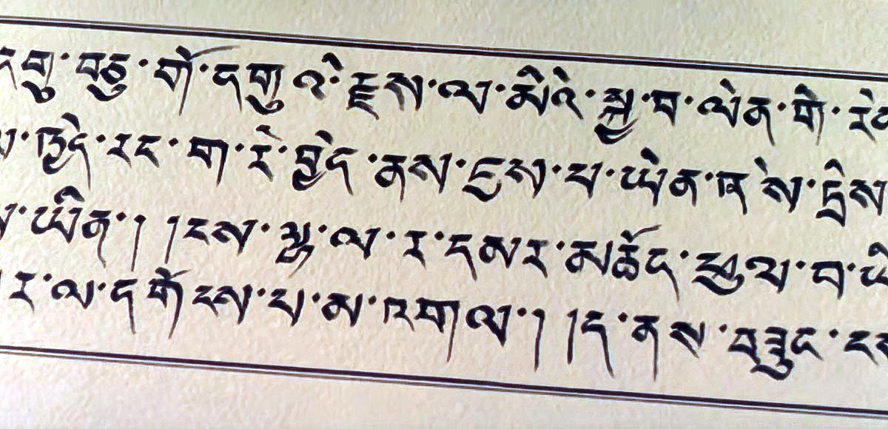
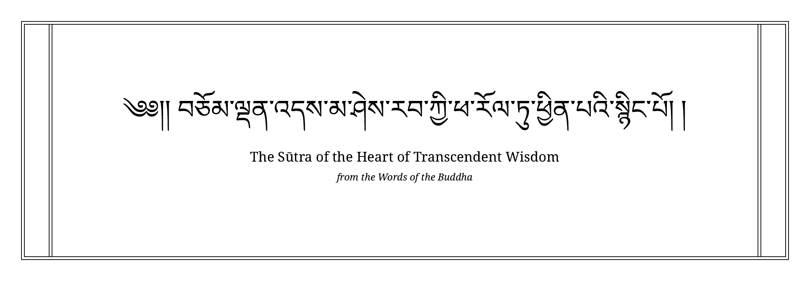
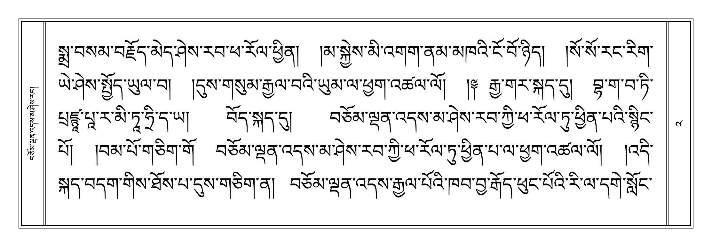

# Pecha

[English](README.md) · [Português](README.pt-BR.md) · **繁體中文**

> [!NOTE]
> 本頁中文版在人工智慧的協助下翻譯，希望方便華人佛教修行者閱讀。譯文尚未經熟悉佛法的中文譯者審閱，難免有疏漏之處，若有錯誤，敬請見諒；日後的版本將繼續校訂改進。🙏

    

*伯納多·貝托魯奇（Bernardo Bertolucci）於 1993 年執導的電影《小活佛》（Little Buddha）開場的一幕。在 YouTube 上觀看這一幕：[葡萄牙語配音版](https://youtu.be/cAbgJ4YUvE4?t=15s)或[英語原版](https://youtu.be/qG78yS0sScA)。*

我第一次在視覺上接觸藏文，是在伯納多·貝托魯奇於 1993 年上映的電影《小活佛》的開場畫面中。在這些畫面裡，一部藏式長條經書（pecha）講述了《本生經》中的一個故事，也就是佛陀過去世的故事。我們既看到傳統形式的經頁，也看到字母在銀幕上飄浮。

後來，我與佛法結緣，特別是與喜馬拉雅的金剛乘傳統結緣；隨著時間，我學了一點藏文，也開始對傳統樣式的 pecha 產生興趣。起初，用電腦製作 pecha 要花很多工夫。如今，隨著科技與藏文字型排版的進步，已經有一些資源能幫助保存經、祈請文與成就法的傳統樣式。

我希望這個技能（skill）能幫助那些想讓自己的文本更接近傳統形式的人，並在長遠上有助於保存這些文本與藏文化。它也可以支持更重要的工作，例如將藏文文本數位化，並翻譯成英文及其他語言。願此能利益修行者，不一定是出於學術上的好奇，而是為了真誠的佛法修持。

— 蔣揚索巴（Jamyang Zopa）

## 從哪裡開始

- [自己製作](#自己製作)：下載技能，製作你的第一部 pecha
- [如何使用 pecha 技能](docs/how-to-use.zh-Hant.md)：每一個步驟，以及需要在 Claude 中開啟的設定
- [如何列印 pecha](docs/printing.zh-Hant.md)：單面列印或雙面列印
- [Pecha 文庫](library/README.zh-Hant.md)：可直接下載並列印的 pecha
- [藏傳佛教中的網路、文本與傳法](docs/internet-and-transmissions.zh-Hant.md)：哪些文本是公開的
- [技能內部如何運作](docs/how-it-works.zh-Hant.md)：它如何讀取網頁並排出 pecha
- [藏文](docs/tibetan-script.zh-Hant.md)：起源與字母

## 技能

 
 

*此技能根據 Lotsawa House 的網頁 [Heart Sūtra (with Extras)](https://www.lotsawahouse.org/words-of-the-buddha/heart-sutra-with-extras)（Adam Pearcey 翻譯）產生的《心經》封面、只有藏文的第 2 條 pecha，以及含藏文、音譯與翻譯的第 6 條 pecha。文本採用 CC BY-NC 4.0 授權，僅供學習與修持。*

這是一個為 Claude 設計的技能，將藏文儀軌文本排版成可列印的 pecha：每張 A4 橫向紙上有兩條 297 × 105 mm 的 pecha，附有雙框、藏文頁碼、封面與致謝頁。文本取自 [Lotsawa House](https://www.lotsawahouse.org) 的網頁。pecha 可以只有藏文，採用較傳統的形式；也可以附上音譯與翻譯，方便學習藏文的人。

> [!IMPORTANT]
> 只收錄 Lotsawa House 標示為**不需要**灌頂或口傳的文本。由於每一部 pecha 都是在人工智慧的協助下製作，請在列印用於學習與修持之前，逐一檢查。

此技能依照每個 Lotsawa House 網頁所標示的層來讀取，並一字不差地複製藏文。它不會重新打字，也不會重新翻譯任何內容。每份 PDF 的最後一條 pecha 載有該網頁提供的致謝資訊：來源、譯者、版本、網址與授權。想了解此技能如何讀取網頁並排出 pecha，以及為什麼這樣設計，請閱讀[技能內部如何運作](docs/how-it-works.zh-Hant.md)。

## 範例 pecha

以下是此技能製作的三部 pecha，每一部代表一種文本排版方式，可直接下載查看。

- [Heart Sūtra (with Extras)](library/heart-sutra-with-extras.pdf)：三層，兩條細線。Adam Pearcey 翻譯，取自 [Lotsawa House](https://www.lotsawahouse.org/words-of-the-buddha/heart-sutra-with-extras)。唸誦：[影片 1](https://youtu.be/-TWtQu79mkk)、[影片 2](https://youtu.be/gR3aiyZVKWc)
- [Treasury of Blessings](library/treasury-blessings-practice-buddha-shakyamuni.pdf)：兩個區塊，內側為粗線。Rigpa Translations 翻譯（參考既有譯本），取自 [Lotsawa House](https://www.lotsawahouse.org/tibetan-masters/mipham/treasury-blessings-practice-buddha-shakyamuni)。唸誦：[影片 1](https://youtu.be/SbU3WiSdFSQ)、[影片 2](https://youtu.be/z8Kvsq1Wwrk)
- [The Sūtra of Boundless Life](library/sutra-boundless-life.pdf)：只有藏文，內側為粗線。Adam Pearcey 翻譯，取自 [Lotsawa House](https://www.lotsawahouse.org/words-of-the-buddha/sutra-boundless-life)。唸誦：[影片](https://youtu.be/fiy8z-pr9EY)

這些文本與翻譯採用 CC BY-NC 4.0 授權，在此非營利地分享，供佛法的學習與修持。

## Pecha 文庫

[Pecha 文庫](library/README.zh-Hant.md)匯集了 108 部文本，並持續增加，收錄的一律是 Lotsawa House 公開發表、不需要灌頂或口傳、採用創用 CC BY-NC 4.0 授權的文本。

- **經**：6 部 pecha
- **陀羅尼與咒**：13 部 pecha
- **上師祈請文**：10 部 pecha
- **Leu Dünma**：8 部 pecha
- **諦實祈請文**：8 部 pecha
- **祈願文**：34 部 pecha
- **讚與迴向**：24 部 pecha
- **修法**：5 部 pecha

各個文集與上師如何處理網路上的文本與傳法，請見[藏傳佛教中的網路、文本與傳法](docs/internet-and-transmissions.zh-Hant.md)。

## 自己製作

1. 下載技能：[pecha-2026.10.22.skill](https://github.com/eltonmelo21/pecha/releases/download/v2026.10.22/pecha-2026.10.22.skill)，目前的版本。
2. 在 Claude 中，點選你的姓名縮寫與名字，再點 **Settings**。在 **Customize** 下點選 **Skills**，接著點 **+**、**+ Create skill** 和 **Upload a skill**，然後選擇該檔案。
3. 對 Claude 說：`Make a pecha of this Lotsawa House page: https://www.lotsawahouse.org/...`

> [!TIP]
> 請使用 Claude Sonnet 或更大的模型。在目前的測試中，低的思考強度（effort）就已足夠。在較複雜的情況下，可能需要更大的模型（例如 Opus）或更高的思考強度。若想用說的而不用打字，可以使用聽寫：訊息框中的麥克風 🎙️。

第一次使用嗎？指南[如何使用 pecha 技能](docs/how-to-use.zh-Hant.md)會說明每一個步驟，以及需要在 Claude 設定中開啟的項目。在 claude.ai 與桌面應用程式中操作方式相同；在手機上，請先從電腦安裝，之後手機上也會出現。

如需單面列印或雙面列印，請見[如何列印 pecha](docs/printing.zh-Hant.md)。

## 藏文與 Google Noto 字型

*圖片：Google。*

藏文使用 Noto Serif Tibetan 字型排版，它屬於 Google 的 [Noto](https://fonts.google.com/noto) 字型家族，旨在涵蓋世界各地的書寫系統。這個名稱來自「no tofu」，指缺少字元時出現的空白小方框。

> [!TIP]
> [觀看 Google 介紹 Noto 誕生的影片](https://youtu.be/16_NYHUZ1kM)。藏文方面，日本設計師 Toshi Omagari 研究了傳統書法，並由僧人審閱字形。可在 Google Fonts 認識 [Noto Serif Tibetan](https://fonts.google.com/noto/specimen/Noto+Serif+Tibetan)。

這些字型是開放的，任何人都可以使用，檔案位於 [GitHub 上的 Noto 專案](https://github.com/notofonts/tibetan)。若想進一步認識藏文本身，請閱讀[藏文](docs/tibetan-script.zh-Hant.md)，其中介紹起源與字母，或參閱維基百科的 [Tibetan script](https://en.wikipedia.org/wiki/Tibetan_script)。

## 給譯者與機構

佛法的教授說，數百年前翻譯佛陀言教的譯者，至今仍在累積廣大的功德。他們的工作讓這些教授能傳到其他民族。今天的譯者也是如此：他們將這些教授數位化並翻譯成其他語言，透過網路所提供的善巧方便，讓教授更容易取得。

> [!NOTE]
> Pecha 是一項非營利的計畫，歡迎擁有更多人工智慧資源與更多時間的基金會、大學或其他機構接續這項工作，讓它傳到更多人手中。

我希望這個技能能支持他們的工作，幫助保存與傳遞教授，特別是藏傳的教授，留給未來的世代。如果你從事翻譯，並想談談這個專案，本儲存庫的 [Discussions](https://github.com/eltonmelo21/pecha/discussions) 是開放的。這可以如何進行，請見[治理](GOVERNANCE.zh-Hant.md)。下一階段的構想請見[未來的構想](docs/future.zh-Hant.md)。若想討論，只要在本儲存庫 Discussions 的 [Partnerships](https://github.com/eltonmelo21/pecha/discussions/categories/partnerships) 分類中開啟一則對話即可。

## 授權與致謝

| 部分 | 授權 |
|---|---|
| 程式碼（`SKILL.md`、`scripts/`、`assets/pecha-engine.html`、`references/`） | MIT，見 [`LICENSE.txt`](LICENSE.txt) |
| Noto 字型（`assets/fonts/`） | SIL Open Font License 1.1 (OFL)，見 [`OFL.txt`](assets/fonts/OFL.txt) |
| 範例 pecha（`library/`）及上方圖片 | CC BY-NC 4.0，限非商業用途並須註明出處 |

Lotsawa House 採用的 CC BY-NC 4.0 授權，允許在註明出處的前提下將文本改作用於非商業用途。正是這項授權讓這些 pecha 得以實現。

- 文本與翻譯：[Lotsawa House](https://www.lotsawahouse.org) 及其譯者。
- 字型：[The Noto Project Authors](https://fonts.google.com/noto)。

---

以 🙏 製作於巴西聖保羅州奧薩斯庫（Osasco）🙂
