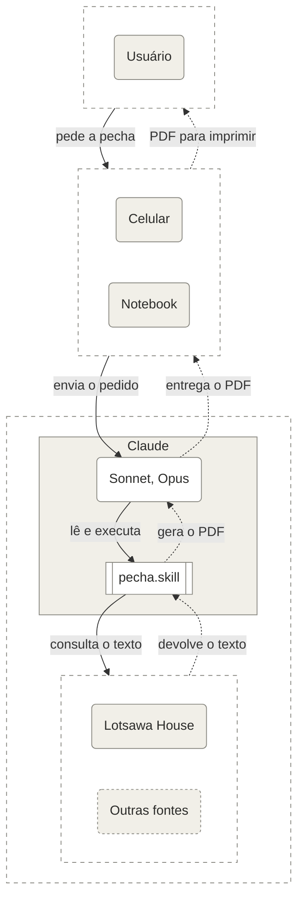
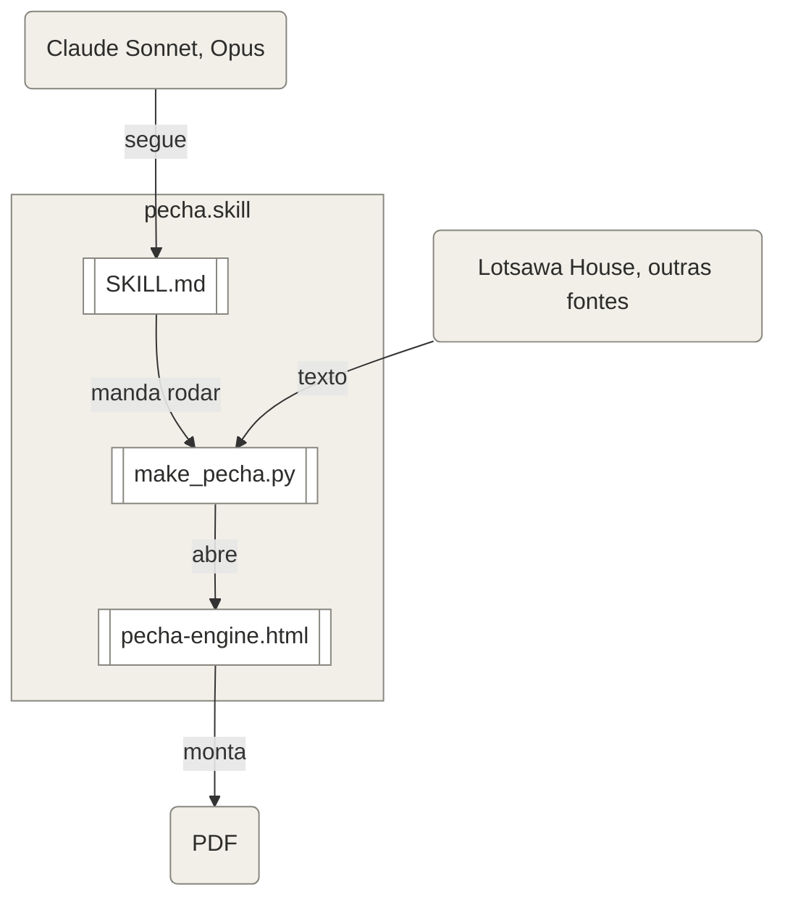

# Como a Skill Funciona por Dentro

[English](how-it-works.md) · **Português** · [繁體中文](how-it-works.zh-Hant.md)

A história de como o projeto começou abre o [README](../README.pt-BR.md). Esta página trata só de como as peças da skill funcionam juntas.

## Visão Geral

Quem participa quando alguém pede uma pecha: a pessoa, o aparelho que ela usa, o Claude com a skill e as fontes do texto.

## As Peças

- **A skill** (`SKILL.md`): as instruções que o Claude segue. Ela diz o que perguntar, quais opções usar e como conferir o resultado.
- **O motor** (`assets/pecha-engine.html`): um único arquivo HTML que faz a diagramação. Ele lê a página, monta as pechas, mede cada uma e decide onde quebrar o texto. Ele roda dentro de um navegador sem tela e não acessa a internet.
- **O script** (`scripts/make_pecha.py`): um programa em Python que abre o motor no Chromium sem tela, por meio do Playwright, passa a página e as opções, e grava o PDF e um relatório com as medidas de cada pecha.
- **As fontes** (`assets/fonts/`): Noto Serif Tibetan para o tibetano, e Noto Serif e Noto Serif Italic para o texto latino, sob a SIL Open Font License.

## A Fonte Tibetana

O tibetano sai em [Noto Serif Tibetan](https://fonts.google.com/noto/specimen/Noto+Serif+Tibetan), da família [Noto](https://fonts.google.com/noto) do Google, desenhada pela [equipe de design da Monotype](https://github.com/notofonts/tibetan). O estudo da escrita tibetana para a Noto Tibetan foi feito pelo designer de tipos Toshi Omagari, que trabalhou na Monotype de 2012 a 2020, com o apoio do estudioso budista Shojiro Nomura e a revisão de monges tibetanos. O caderno de esboços dele, com os primeiros desenhos da Noto Tibetan, foi doado ao Design Museum, e ele apresentou a palestra "Making Noto Sans Tibetan" na conferência Granshan de 2015 ([perfil de Toshi Omagari](https://tosche.net/profile) e [estudo de caso da Monotype](https://enterprise.monotype.com/resources/case-studies/creating-noto-google)).

*Imagem: Google. Clique nela para ver no YouTube o vídeo "Creating Noto for Google", da Monotype, sobre como as fontes Noto foram criadas.*

## Do Endereço ao PDF

1. A pessoa pede uma pecha e dá o endereço de uma página da Lotsawa House, ou anexa a página salva.
2. O Claude, seguindo a skill, pergunta só o que a página deixa em aberto, como os títulos que o tradutor colocou no meio do texto.
3. O script abre o motor, que lê as camadas pela marcação da própria página: tibetano, transliteração e tradução. Nenhuma inteligência artificial lê ou reescreve o texto nesse caminho ([`SKILL.md`](../SKILL.md)).
4. O motor monta as pechas de 297 × 105 mm, duas por folha A4 paisagem, e o script grava o PDF.
5. O Claude confere o relatório, escolhe o nome do texto para a margem e entrega o PDF.

Quando o texto vem de outra fonte, como outro site ou uma tradução própria, o Claude converte o texto para um formato intermediário e a pessoa confere antes do PDF. Em qualquer caminho, a página de créditos diz que a pecha foi preparada com apoio de inteligência artificial e precisa ser revisada antes do estudo e da prática.

Dentro do pacote da skill, três peças fazem o trabalho, uma depois da outra:

## Decisões de Desenho

### Título Curto na Margem e Numeração em Algarismos Tibetanos

Cada pecha leva, na margem esquerda, o nome curto do texto em tibetano e, na margem direita, o número da pecha em algarismos tibetanos, como numa pecha tradicional. O nome da margem é escolhido pela skill a partir do título do texto, porque o corte automático às vezes devolve o nome do ciclo, e não o da prece.

### Título Maior na Capa

A capa traz o título tibetano a partir de 28 pt e o título traduzido em 14 pt. O tamanho foi escolhido comparando quatro combinações na mesma capa, porque o título traduzido em 12 pt ficava pequeno demais perto do tibetano.

### Linhas da Moldura

A moldura dupla sai com duas linhas finas por padrão. Para uma moldura mais marcada, uma linha de cada par pode ser grossa: a grossa por fora, ou a grossa por dentro. A moldura cresce para fora o que a linha grossa acrescenta, e o texto quebra nos mesmos pontos nas três molduras.

### Impressão em Frente e Verso

A pecha pode sair em uma face só, que é o padrão, ou em frente e verso. No frente e verso, a skill prepara o PDF para a folha ser virada pela borda longa.

### Títulos do Tradutor

Alguns tradutores colocam no meio do texto títulos só em inglês, sem tibetano. A skill pergunta a cada texto se eles seguem no fluxo, se cada um abre uma pecha nova ou se ficam de fora, porque o melhor caminho muda de um texto para outro.

### Sinal de Terma

Nos textos de tesouro revelado (terma), os versos tibetanos terminam com o sinal ༔. A skill repete esse sinal ao fim da transliteração e da tradução de cada verso que o traz, colado à última palavra. É uma boa prática de edição e um sinal de respeito pelo tesouro revelado. A skill reconhece o terma sozinha, quando a maioria dos versos tibetanos termina com o sinal ([`SKILL.md`](../SKILL.md)).

### Tamanho do Tibetano

O tibetano sai em 19 pt quando divide a pecha com outras camadas e em 21 pt quando vem sozinho. O espaço em branco é medido da moldura até o corpo das letras, e não até os sinais de vogal, para que a pecha pareça equilibrada a olho nu.
