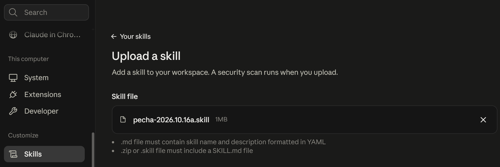
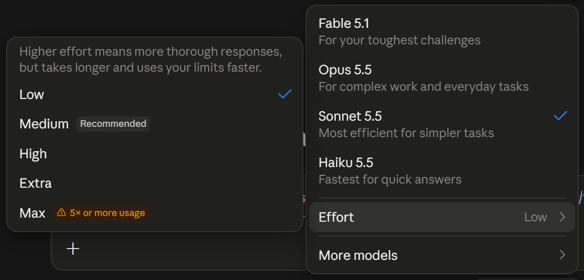

# Como Usar a Skill Pecha

[English](how-to-use.md) · **Português** · [繁體中文](how-to-use.zh-Hant.md)

Este guia é para quem nunca usou inteligência artificial. Ele leva da instalação até a pecha impressa, um passo de cada vez. Você não precisa digitar nenhum comando técnico.

A skill pecha transforma uma página da [Lotsawa House](https://www.lotsawahouse.org) num PDF pronto para imprimir. Cada folha A4 traz duas pechas, com moldura, capa e créditos. Ela é para quem pratica e quer o texto no formato de pecha, só em tibetano ou com transliteração e tradução.

Toda pecha é preparada com apoio de inteligência artificial. Por isso ela precisa ser revisada antes do estudo e da prática, e o guia mostra como fazer isso antes de imprimir.

Os nomes dos menus estão em inglês, como aparecem no Claude. Eles foram conferidos na central de ajuda do Claude em 11 de outubro de 2026 e podem mudar.

## O Que Você Vai Precisar

- Uma conta no [Claude](https://claude.ai). A skill funciona no plano gratuito e também nos planos pagos ([planos do Claude](https://claude.com/pricing), conferido em 11 de outubro de 2026). Skills e execução de código estão nos planos Free, Pro, Max, Team e Enterprise ([ajuda do Claude](https://support.claude.com/en/articles/12512180-use-skills-in-claude), conferido em 11 de outubro de 2026).
- O Claude no navegador, no aplicativo do Claude para computador ou no aplicativo do celular ([ajuda do Claude](https://support.claude.com/en/articles/15520349-use-claude-cowork-on-web-desktop-and-mobile), conferido em 11 de outubro de 2026). A skill foi testada no aplicativo do celular em 11 de outubro de 2026.
- Uma impressora que imprima em folha A4, de preferência a laser.

## Parte 1: Preparar o Claude (Só na Primeira Vez)

### 1. Ligar a Execução de Código

A skill precisa que o Claude possa rodar programas para montar o PDF.

1. No Claude, abra **Settings** (configurações).
2. Entre em **Capabilities**.
3. Ligue a opção **Code execution and file creation**.
4. Depois, em **Customize**, clique em **Skills** e confira se as skills estão ligadas.

Nos planos Team e Enterprise, quem administra a conta da organização liga a execução de código e as skills em **Organization settings**, **Plugins & skills**, na aba **Policy**.

Caminho conferido na [ajuda do Claude](https://support.claude.com/en/articles/12512180-use-skills-in-claude) em 11 de outubro de 2026.

### 2. Baixar o Pacote da Skill

1. Clique em [pecha-2026.10.22.skill](https://github.com/eltonmelo21/pecha/releases/download/v2026.10.22/pecha-2026.10.22.skill) para baixar a versão atual. Se precisar de uma versão anterior, abra a página de [Releases](https://github.com/eltonmelo21/pecha/releases) deste projeto.
2. Guarde o arquivo numa pasta fácil de achar, como Downloads. Não precisa abrir o arquivo.

### 3. Instalar a Skill no Claude

1. No Claude, clique nas suas iniciais e no seu nome, depois em **Settings**. Em **Customize**, clique em **Skills**.
2. Clique no botão **+** e depois em **+ Create skill**.
3. Escolha **Upload a skill**.
4. Envie o arquivo que você baixou no passo 2.
5. Confira se a skill **pecha** aparece na lista com a chave ligada.



Caminho conferido na [ajuda do Claude](https://support.claude.com/en/articles/12512180-use-skills-in-claude) em 11 de outubro de 2026.

### Atualizar para uma Versão Nova

A skill instalada não muda sozinha quando sai uma versão nova. Para saber qual versão você tem, abra a última pecha de qualquer PDF que ela gerou: os créditos dizem "pecha.skill, version" (ou "pecha.skill, versão", nos créditos em português) seguido da versão, como 2026.10.22.

Para passar a uma versão nova, baixe o arquivo novo, como no passo 2, e troque a skill antiga:

1. Em **Settings**, na parte **Customize**, clique em **Skills** e depois na skill **pecha**.
2. Desligue a chave, no canto de cima.
3. Clique no botão **...**, ao lado da chave, e depois em **Delete**. Confirme em **Delete**.
4. Envie o arquivo novo, como no passo 3.

A ajuda do Claude não descreve outro jeito de trocar uma skill enviada: você apaga e envia de novo ([ajuda do Claude](https://support.claude.com/en/articles/12512180-use-skills-in-claude), conferida em 16 de outubro de 2026).

### Ser Avisado Quando Sair uma Versão Nova

Com uma conta no GitHub, você pode ser avisado de cada versão nova:

1. Abra a página deste projeto no GitHub, [eltonmelo21/pecha](https://github.com/eltonmelo21/pecha), e entre na sua conta.
2. Clique em **Watch**, no alto da página, e depois em **Custom**.
3. Marque **Releases** e confirme.

Cada versão nova passa a aparecer nas suas notificações do GitHub, e também por e-mail, se as notificações por e-mail estiverem ligadas nas configurações do GitHub ([documentação do GitHub](https://docs.github.com/en/subscriptions-and-notifications/get-started/configuring-notifications), conferida em 16 de outubro de 2026). Sem conta, abra de vez em quando a página de [Releases](https://github.com/eltonmelo21/pecha/releases).

## Parte 2: Fazer uma Pecha

### 4. Escolher o Texto na Lotsawa House

1. Abra a [Lotsawa House](https://www.lotsawahouse.org) e encontre o texto.
2. Copie o endereço da página, na barra do navegador. Ele começa com `https://www.lotsawahouse.org/`.

Use só textos que você pode praticar. Alguns textos pedem iniciação ou transmissão de um mestre.

### 5. Pedir a Pecha ao Claude

Abra uma conversa nova no Claude, copie uma das frases abaixo, troque o endereço pelo da sua página e envie.

Com tibetano, transliteração e tradução:

```
Faça uma pecha desta página da Lotsawa House, com tibetano, transliteração e tradução: https://www.lotsawahouse.org/...
```

Só em tibetano:

```
Faça uma pecha só em tibetano desta página da Lotsawa House: https://www.lotsawahouse.org/...
```

O Claude usa a skill sozinho. Na primeira vez, ele pode levar alguns minutos para se preparar. Ele gera a pecha com os padrões e, junto do PDF, diz quais escolhas usou: camadas, blocos, impressão, moldura e, quando a página tem, os títulos do tradutor. Para mudar alguma, basta pedir com as suas palavras.

Se o PDF não sair, veja [Modelos do Claude](#modelos-do-claude), logo abaixo. Para mudar as camadas, a moldura, a impressão ou os títulos do tradutor, veja [Escolhas da Pecha](#escolhas-da-pecha), no fim deste guia.

### Modelos do Claude

O Claude tem modelos diferentes, e cada um tem níveis de esforço. Para escolher, clique no nome do modelo, ao lado do botão de enviar, depois em **Effort**, e escolha o nível ([ajuda do Claude](https://support.claude.com/en/articles/8664678-change-the-model-effort-and-thinking-settings), conferido em 11 de outubro de 2026).



Testado em 11 de outubro de 2026, no aplicativo do celular: o Haiku com esforço alto (**High**) gerou o PDF. Com esforço baixo e médio, o Haiku não gerou. Testado em 13 de outubro de 2026: o Sonnet com esforço baixo gerou o PDF de uma prática diária em três camadas. O Opus ainda não foi testado com esta versão da skill.

A recomendação é usar o Claude Sonnet ou um modelo maior. O esforço baixo bastou nos testes feitos até agora; em casos mais complexos, um modelo maior, como o Opus, ou um esforço mais alto podem ser necessários.

Em outras plataformas de inteligência artificial, como ChatGPT, Gemini e Grok, a skill ainda não foi testada.

### 6. Se o Claude Não Conseguir Abrir o Endereço

Salve a página no seu computador e envie o arquivo para o Claude:

1. Na página da Lotsawa House, use o menu do navegador **Salvar página como** (no teclado, Ctrl+S, ou Cmd+S no Mac).
2. Escolha o formato **Página da Web, somente HTML**.
3. Na conversa com o Claude, anexe esse arquivo pelo clipe ou pelo botão **+**, e envie a mesma frase do passo 5, trocando o endereço por "desta página que anexei".

### 7. Baixar o PDF

Quando terminar, o Claude mostra o PDF na conversa. Clique nele para baixar.

## Parte 3: Revisar e Imprimir

### 8. Revisar Antes de Usar

Revise a pecha antes de imprimir. Abra todas as páginas do PDF e confira:

- se o texto está completo, do início ao fim;
- se alguma pecha ficou quase vazia;
- se alguma palavra ficou colada na moldura ou em outra palavra.

Se algo estiver errado, diga ao Claude na mesma conversa o que viu e em qual página.

### 9. Imprimir

1. Imprima em folha **A4**, na orientação **paisagem**, de preferência numa impressora a laser.
2. Na janela de impressão, escolha escala **100%** (ou "tamanho real"). Não use "ajustar à página".
3. Se você pediu a pecha para frente e verso, escolha a virada pela **borda longa**.
4. Cada folha traz duas pechas, uma em cima e outra embaixo. Corte na linha tracejada do meio, de preferência com uma guilhotina para papel, para o corte sair reto.

Os nomes das opções em cada impressora, a ordem das pechas no frente e verso e os cuidados com a linha de corte estão em [Como Imprimir as Pechas](impressao.md).

## Escolhas da Pecha

Sem nenhum pedido, a pecha sai com o padrão de cada escolha abaixo. Para mudar, acrescente a frase pronta ao seu pedido do passo 5, ou envie a frase depois, na mesma conversa, para receber uma nova versão do PDF.

### Camadas

O padrão é tibetano, transliteração e tradução: cada verso em tibetano, com a leitura em letras latinas logo abaixo e a tradução depois.

Só em tibetano, como nas pechas tradicionais. O tibetano fica um pouco maior quando está sozinho:

```
Quero a pecha só em tibetano.
```

Tibetano e tradução, sem a transliteração, indicado para quem estuda a língua tibetana:

```
Quero a pecha com tibetano e tradução, sem a transliteração.
```

Outras combinações também funcionam, por exemplo tibetano e transliteração, sem a tradução:

```
Quero a pecha com tibetano e transliteração, sem a tradução.
```

### Dois Blocos

O padrão é ter todas as camadas juntas em cada pecha. Também é possível ter dois blocos: primeiro o texto inteiro só em tibetano e, depois, a partir de uma pecha nova, a transliteração e a tradução, com uma capa só. Assim o tibetano e o texto latino ficam no tamanho normal mesmo nos textos com parágrafos longos, em troca de algumas folhas a mais. Junto do PDF, o Claude recomenda os dois blocos quando o texto inteiro precisou de letra menor:

```
Quero a pecha em dois blocos: primeiro o tibetano, depois a transliteração e a tradução.
```

### Linhas da Moldura

O padrão é a moldura com duas linhas finas. As alternativas têm uma linha grossa e uma fina, com a grossa por fora:

```
Quero a moldura com a linha grossa por fora.
```

ou com a grossa por dentro:

```
Quero a moldura com a linha grossa por dentro.
```

O texto quebra nos mesmos pontos nas três molduras.

### Uma Face ou Frente e Verso

O padrão é imprimir só de um lado da folha, em uma face. Se a sua impressora imprime frente e verso, peça a pecha preparada para isso. Na hora de imprimir, a folha é virada pela borda longa:

```
Quero a pecha para imprimir em frente e verso.
```

### Títulos do Tradutor

Algumas traduções trazem títulos que o tradutor colocou no meio do texto, sem tibetano, por exemplo o nome de cada parte da prática. O padrão é imprimir esses títulos no meio do texto, junto da estrofe que cada um abre. Quando a página tem esses títulos, o Claude cita alguns deles junto do PDF.

Cada título abrindo uma pecha nova, bom quando os títulos abrem partes longas do texto:

```
Quero que cada título do tradutor comece uma pecha nova.
```

Os títulos deixados de fora, só com o texto da prática:

```
Quero a pecha sem os títulos do tradutor.
```

### Sinal de Terma

Os textos de tesouro (terma) terminam os versos tibetanos com o sinal ༔. Nesses textos, a skill repete o sinal no fim da transliteração e da tradução de cada verso que termina com ele no tibetano, sozinha, sem você precisar pedir. Esse é o padrão. Para tirar o sinal da transliteração e da tradução:

```
Quero a pecha sem repetir o sinal de terma na transliteração e na tradução.
```

---

A pecha feita com textos da Lotsawa House segue a licença CC BY-NC 4.0: serve para estudo e prática, sem venda.
