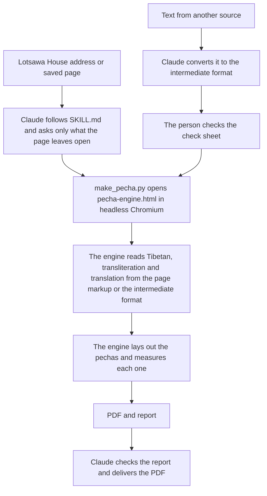

# How the Skill Works Inside

**English** · [Português](como-funciona.md)

The story of how the project began opens the [README](../README.md). This page covers only how the parts of the skill work together.

## The Parts

- **The skill** (`SKILL.md`): the instructions Claude follows. It says what to ask, which options to use and how to check the result.
- **The engine** (`assets/pecha-engine.html`): a single HTML file that does the layout. It reads the page, builds the pechas, measures each one and decides where to break the text. It runs inside a browser with no screen and does not access the internet.
- **The script** (`scripts/make_pecha.py`): a Python program that opens the engine in headless Chromium, through Playwright, passes the page and the options, and saves the PDF and a report with the measurements of each pecha.
- **The fonts** (`assets/fonts/`): Noto Serif Tibetan for the Tibetan, and Noto Serif and Noto Serif Italic for the Latin text, under the SIL Open Font License.

## The Tibetan Font

The Tibetan is set in [Noto Serif Tibetan](https://fonts.google.com/noto/specimen/Noto+Serif+Tibetan), part of Google's [Noto](https://fonts.google.com/noto) family, designed by the [Monotype design team](https://github.com/notofonts/tibetan). The study of the Tibetan script for Noto Tibetan was done by the type designer Toshi Omagari, who worked at Monotype from 2012 to 2020, with the support of the Buddhist scholar Shojiro Nomura and the review of Tibetan monks. His sketchbook with the first drawings of Noto Tibetan was donated to the Design Museum, and he gave the talk "Making Noto Sans Tibetan" at the Granshan conference in 2015 ([Toshi Omagari's profile](https://tosche.net/profile) and [Monotype's case study](https://enterprise.monotype.com/resources/case-studies/creating-noto-google)).

*Image: Google. Click it to watch "Creating Noto for Google", Monotype's video about how the Noto fonts were made, on YouTube.*

## From the Address to the PDF

1. The person asks for a pecha and gives the address of a Lotsawa House page, or attaches the saved page.
2. Claude, following the skill, asks only what the page leaves open, such as the headings the translator placed inside the text.
3. The script opens the engine, which reads the layers from the page's own markup: Tibetan, transliteration and translation. No artificial intelligence reads or rewrites the text on this path ([`SKILL.md`](../SKILL.md)).
4. The engine builds the pechas of 297 × 105 mm, two on each A4 landscape sheet, and the script saves the PDF.
5. Claude checks the report, chooses the name of the text for the margin and delivers the PDF.

When the text comes from another source, such as another site or one's own translation, Claude converts it to an intermediate format and the person checks it before the PDF. On either path, the credits page says the pecha was prepared with the help of artificial intelligence and must be reviewed before study and practice.

## Design Decisions

### Short Title in the Margin and Tibetan Page Numbers

Each pecha carries, in the left margin, the short name of the text in Tibetan and, in the right margin, the number of the pecha in Tibetan numerals, as in a traditional pecha. The skill chooses the margin name from the title of the text, because an automatic cut sometimes returns the name of the cycle instead of the name of the prayer.

### Larger Title on the Cover

The cover carries the Tibetan title from 28 pt and the translated title in 14 pt. The size was chosen by comparing four combinations on the same cover, because the translated title in 12 pt was too small next to the Tibetan.

### Frame Lines

The double frame uses two thin lines by default. For a stronger frame, one line of each pair can be thick: the thick line outside, or the thick line inside. The frame grows outwards by the extra width, so the text breaks at the same points in the three frames.

### Double-Sided Printing

The pecha can be printed on one side only, which is the default, or double-sided. In double-sided printing, the skill prepares the PDF for the sheet to flip on the long edge.

### Translator Headings

Some translators place headings inside the text in English only, with no Tibetan. The skill asks for each text whether they stay in the flow, whether each one opens a new pecha, or whether they are left out, because the best choice changes from one text to another.

### The Terma Mark

In texts of revealed treasure (terma), the Tibetan verses end with the mark ༔. The skill repeats this mark at the end of the transliteration and of the translation of each verse that carries it, attached to the last word. It is good editorial practice and a sign of respect for the revealed treasure. The skill recognises a terma on its own, when most Tibetan verses end with the mark ([`SKILL.md`](../SKILL.md)).

### Size of the Tibetan

The Tibetan is set in 19 pt when it shares the pecha with other layers and in 21 pt when it stands alone. The white space is measured from the frame to the body of the letters, and not to the vowel signs, so that the pecha looks balanced to the eye.
