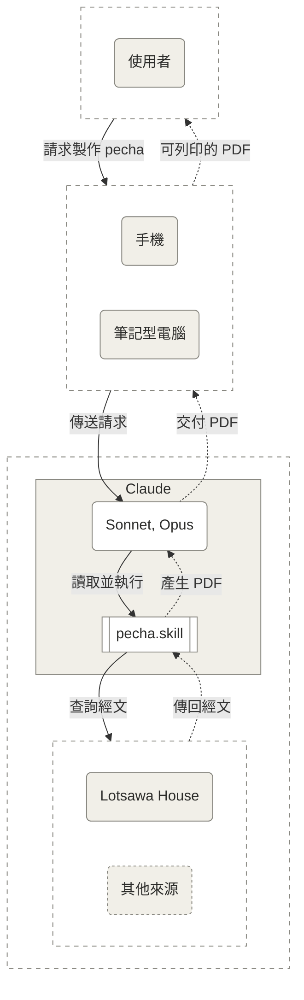
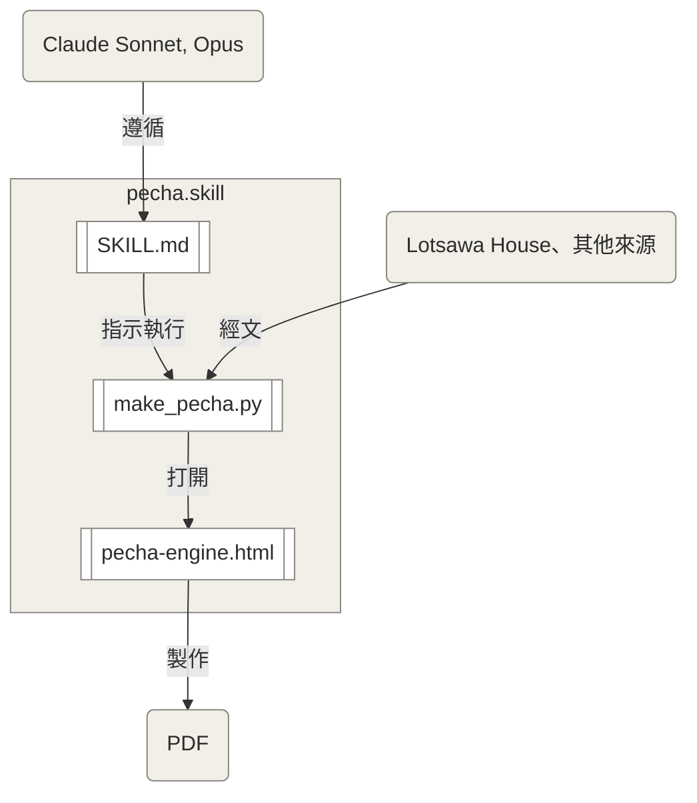

# 技能內部如何運作

[English](how-it-works.md) · [Português](como-funciona.md) · **繁體中文**

> [!NOTE]
> 本頁中文版在人工智慧的協助下翻譯，希望方便華人佛教修行者閱讀。譯文尚未經熟悉佛法的中文譯者審閱，難免有疏漏之處，若有錯誤，敬請見諒；日後的版本將繼續校訂改進。🙏

本專案如何開始的故事寫在 [README](../README.zh-Hant.md) 的開頭。本頁只說明這個技能（skill）的各個部分如何協同運作。

## 概觀

有人請求製作 pecha 時參與其中的各方：使用者、使用者的裝置、帶有技能的 Claude，以及經文的來源。

## 各個部分

- **技能**（`SKILL.md`）：Claude 遵循的指示。它說明要詢問什麼、使用哪些選項，以及如何檢查結果。
- **引擎**（`assets/pecha-engine.html`）：負責排版的單一 HTML 檔案。它讀取網頁、製作藏式長條經書（pecha）、測量每一條 pecha，並決定經文在哪裡換行。它在沒有畫面的瀏覽器中執行，不會連上網路。
- **腳本**（`scripts/make_pecha.py`）：一個 Python 程式，透過 Playwright 在 headless Chromium 中打開引擎，傳入網頁和選項，並儲存 PDF 以及記錄每一條 pecha 測量數據的報告。
- **字型**（`assets/fonts/`）：藏文使用 Noto Serif Tibetan，拉丁文字使用 Noto Serif 和 Noto Serif Italic，採用 SIL Open Font License。

## 藏文字型

藏文以 [Noto Serif Tibetan](https://fonts.google.com/noto/specimen/Noto+Serif+Tibetan) 排版，它屬於 Google 的 [Noto](https://fonts.google.com/noto) 字型家族，由 [Monotype 設計團隊](https://github.com/notofonts/tibetan)設計。Noto Tibetan 的藏文字體研究由字體設計師 Toshi Omagari 完成，他在 2012 年至 2020 年間任職於 Monotype，並得到佛教學者 Shojiro Nomura 的支持與藏族僧人的審閱。他繪有 Noto Tibetan 最初草圖的速寫本已捐贈給 Design Museum，他也在 2015 年的 Granshan 研討會上發表了演講「Making Noto Sans Tibetan」（[Toshi Omagari 的個人簡介](https://tosche.net/profile)與 [Monotype 的案例研究](https://enterprise.monotype.com/resources/case-studies/creating-noto-google)）。

*圖片：Google。點選圖片即可在 YouTube 上觀看「Creating Noto for Google」，這是 Monotype 介紹 Noto 字型製作過程的影片。*

## 從網址到 PDF

1. 使用者請求製作 pecha，並提供 Lotsawa House 網頁的網址，或附上已儲存的網頁。
2. Claude 依照技能的指示，只詢問網頁沒有確定的事項，例如譯者放在經文中的標題。
3. 腳本打開引擎，引擎從網頁本身的標記讀取各層：藏文、音譯和翻譯。在這條路徑上，沒有任何人工智慧讀取或改寫經文（[`SKILL.md`](../SKILL.md)）。
4. 引擎製作 297 × 105 mm 的 pecha，每張 A4 橫向紙印兩條，腳本再儲存 PDF。
5. Claude 檢查報告，選定頁邊的經文名稱，然後交付 PDF。

當經文來自其他來源，例如其他網站或自己的翻譯時，Claude 會先把它轉換成中間格式，由使用者在製作 PDF 之前檢查。無論走哪一條路徑，致謝頁都會註明這份 pecha 是在人工智慧的協助下製作的，用於學習和修持之前必須先校對。

在技能套件內部，有三個部分依序完成工作：

## 設計上的決定

### 頁邊的簡短標題與藏文頁碼

每一條 pecha 的左側頁邊印有經文的藏文簡稱，右側頁邊印有以藏文數字表示的 pecha 編號，就像傳統的 pecha 一樣。技能從經文的標題中選定頁邊名稱，因為自動擷取有時會得到法類的名稱，而不是祈請文的名稱。

### 封面上較大的標題

封面上的藏文標題從 28 pt 起，翻譯的標題為 14 pt。這個大小是在同一個封面上比較四種組合後選定的，因為 12 pt 的翻譯標題放在藏文旁邊顯得太小。

### 邊框線條

雙線邊框預設使用兩條細線。想要更醒目的邊框，可以讓其中一條線變粗：粗線在外，或粗線在內。邊框會依增加的寬度向外擴展，因此三種邊框中經文換行的位置都相同。

### 雙面列印

pecha 可以只印在一面（這是預設值），也可以雙面列印。雙面列印時，技能會為沿長邊翻轉的紙張準備 PDF。

### 譯者的標題

有些譯者會在經文中加入只有英文、沒有藏文的標題。技能會針對每一部經文詢問：這些標題是留在經文中間、每個標題都從新的一條 pecha 開始，還是省略，因為最好的選擇因經文而異。

### 伏藏符號

在伏藏（terma）經文中，藏文偈頌以符號 ༔ 結尾。技能會在帶有這個符號的每一句偈頌的音譯和翻譯結尾重複這個符號，緊接在最後一個字之後。這是良好的編輯慣例，也是對伏藏的尊重。當大部分藏文偈頌都以這個符號結尾時，技能會自行辨識出這是伏藏（[`SKILL.md`](../SKILL.md)）。

### 藏文的大小

藏文與其他層共用一條 pecha 時為 19 pt，單獨出現時為 21 pt。留白是從邊框量到字母的主體，而不是量到母音符號，這樣 pecha 在視覺上才會顯得平衡。
