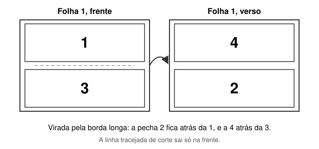

# Como Imprimir as Pechas

[English](printing.md) · **Português** · [繁體中文](printing.zh-Hant.md)

Cada folha A4 traz duas pechas, uma em cima e outra embaixo. A pecha pode sair para imprimir de um lado só da folha, em uma face, ou dos dois lados, em frente e verso.

Esta página reúne o que ajuda na hora de imprimir e de cortar. Os nomes das opções mudam de uma impressora para outra e de um programa para outro; aqui aparecem os mais comuns, em português e em inglês.

## Antes de Imprimir

1. Folha **A4**.
2. Orientação **paisagem**, com a folha na horizontal (*Landscape*).
3. Escala **100%**, no tamanho real (*Actual size*). Não use "ajustar à página" (*Fit*, *Fit to page*, *Shrink to fit*), que muitas impressoras trazem como padrão. Ele diminui a pecha e tira a moldura do lugar.
4. Margens: nenhuma (*None*), quando a janela de impressão oferecer essa opção.
5. De preferência, uma impressora a laser.

## Uma Face

É o padrão da skill. Cada folha é impressa de um lado só, e as pechas seguem a ordem do texto: a folha 1 traz as pechas 1 e 2, a folha 2 traz as pechas 3 e 4, e assim por diante.

Na impressora, deixe a impressão normal, de um lado só.

## Frente e Verso

Para usar os dois lados da folha, peça à skill a pecha preparada para frente e verso:

```
Quero a pecha para imprimir em frente e verso.
```

Nesse PDF, a skill já arruma as pechas para a folha virada. A frente da folha 1 traz as pechas 1 e 3, e o verso traz as pechas 4 e 2. Depois do corte, cada pecha tem a seguinte atrás dela.



Na impressora:

1. Ligue o frente e verso (*Two-sided*, *Duplex*, *Print on both sides*).
2. Escolha a virada pela **borda longa** (*Flip on long edge*, *Long-edge binding*), e não pela borda curta.
3. Mantenha A4, paisagem e escala de 100%.

> [!IMPORTANT]
> Ligar o frente e verso só na impressora, com o PDF de uma face, não funciona: os versos saem trocados. Para imprimir dos dois lados, use o PDF preparado para frente e verso.

Na [biblioteca](../library/README.pt-BR.md), cada pecha está nas duas versões: o link do título abre a de uma face, e o link da coluna Frente e verso abre a preparada para os dois lados.

## A Linha de Corte

Entre as duas pechas de cada folha há uma linha fina, tracejada e cinza clara, que ajuda a fazer o corte exato.

- **Uma face:** a linha aparece em todas as folhas.
- **Frente e verso:** a linha aparece só na frente de cada folha, para a linha da frente e a do verso não ficarem desencontradas na hora do corte.

Dependendo da impressora, a linha pode não cair exatamente no meio da folha. Imprima a primeira folha e confira antes de imprimir o resto. Mesmo fina e clara, a linha pode ficar aparente depois do corte, conforme o lugar por onde a lâmina passa.

## O Corte

Corte na linha do meio, de preferência com uma guilhotina para papel, para o corte sair reto. No frente e verso, corte pela linha da frente.

## Conferir Depois do Corte

Cada pecha traz o seu número em algarismos tibetanos, na margem direita. Numa face, confira se a sequência está completa. No frente e verso, vire cada pecha: atrás da pecha 1 vem a 2, atrás da 3 vem a 4, e assim por diante.
