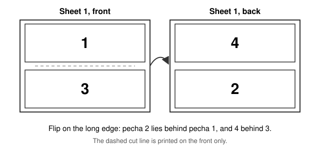

# How to Print the Pechas

**English** · [Português](impressao.md)

Each A4 sheet carries two pechas, one at the top and one at the bottom. A pecha can be made for printing on one side of the sheet only, single-sided, or on both sides, double-sided.

This page gathers what helps when you print and cut. The names of the options change from one printer to another and from one program to another; the most common ones are given here.

## Before You Print

1. **A4** paper.
2. **Landscape** orientation, with the sheet lying horizontally.
3. Scale **100%**, at actual size (*Actual size*). Do not use fit to page (*Fit*, *Fit to page*, *Shrink to fit*), which many printers offer by default. It makes the pecha smaller and moves the frame out of place.
4. Margins: none (*None*), when the print window offers this option.
5. Preferably a laser printer.

## Single-Sided

This is the skill's default. Each sheet is printed on one side only, and the pechas follow the order of the text: sheet 1 carries pechas 1 and 2, sheet 2 carries pechas 3 and 4, and so on.

On the printer, keep normal printing, on one side only.

## Double-Sided

To use both sides of the sheet, ask the skill for the pecha prepared for double-sided printing:

```
I would like the pecha for double-sided printing.
```

In that PDF, the skill already arranges the pechas for the turned sheet. The front of sheet 1 carries pechas 1 and 3, and the back carries pechas 4 and 2. After cutting, each pecha has the next one behind it.



On the printer:

1. Turn on double-sided printing (*Two-sided*, *Duplex*, *Print on both sides*).
2. Choose flipping on the **long edge** (*Flip on long edge*, *Long-edge binding*), not on the short edge.
3. Keep A4, landscape and a scale of 100%.

> [!IMPORTANT]
> Turning on double-sided printing only on the printer, with the single-sided PDF, does not work: the backs come out in the wrong order. To print on both sides, use the PDF prepared for double-sided printing.

In the [library](../library/README.md), each pecha comes in both versions: the title link opens the single-sided one, and the link in the Double-sided column opens the one prepared for both sides.

## The Cut Line

Between the two pechas of each sheet there is a thin, dashed, light grey line that helps you cut exactly.

- **Single-sided:** the line appears on every sheet.
- **Double-sided:** the line appears only on the front of each sheet, so that the lines on the front and on the back do not end up out of step when you cut.

Depending on the printer, the line may not fall exactly in the middle of the sheet. Print the first sheet and check it before printing the rest. Even thin and light, the line may still show after cutting, depending on where the blade passes.

## Cutting

Cut along the line in the middle, preferably with a paper guillotine, so the cut comes out straight. With double-sided printing, cut along the line on the front.

## Checking After Cutting

Each pecha carries its number in Tibetan numerals in the right margin. With single-sided printing, check that the sequence is complete. With double-sided printing, turn each pecha over: behind pecha 1 comes 2, behind 3 comes 4, and so on.
